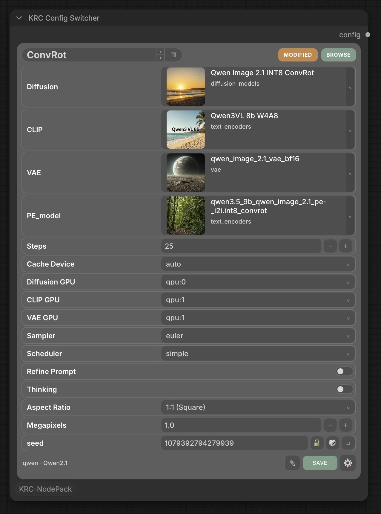
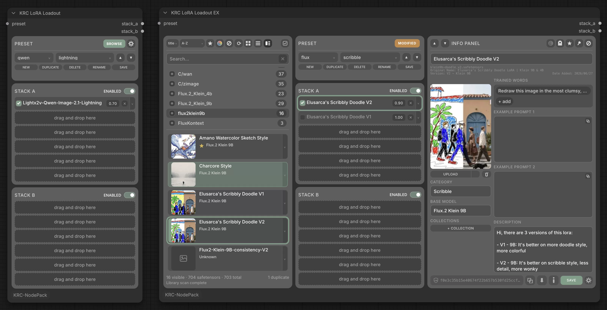
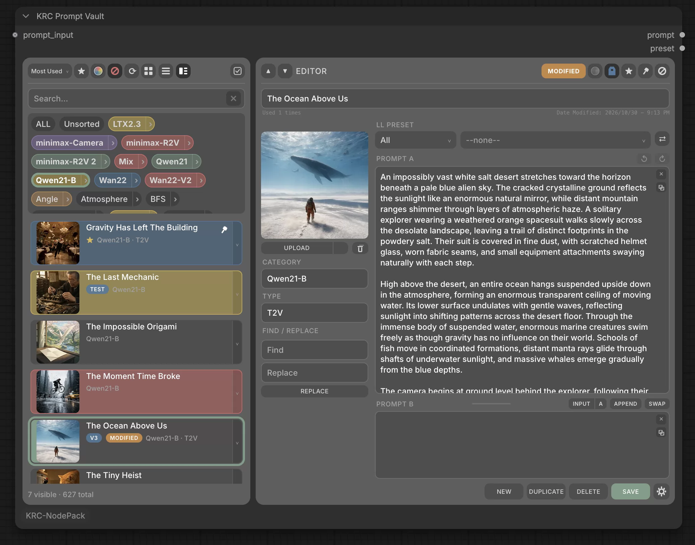
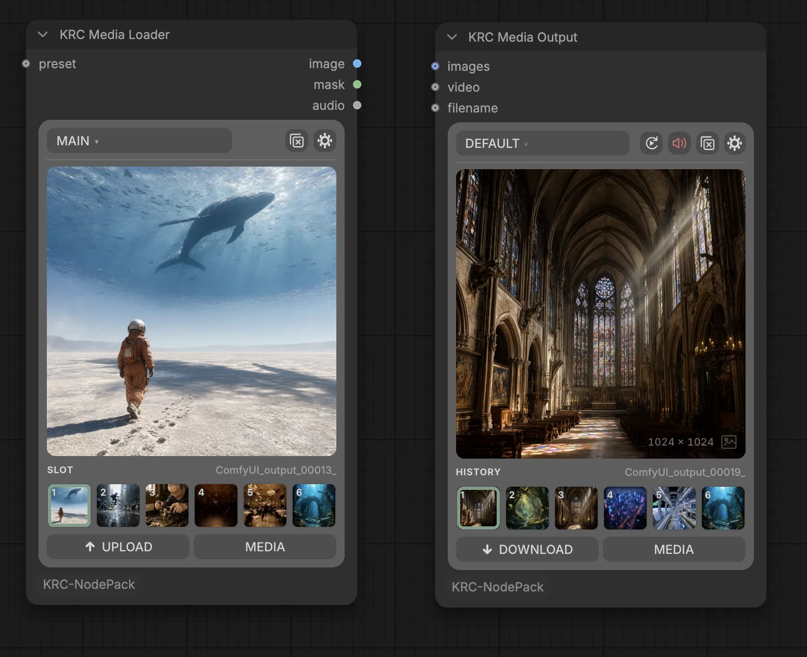
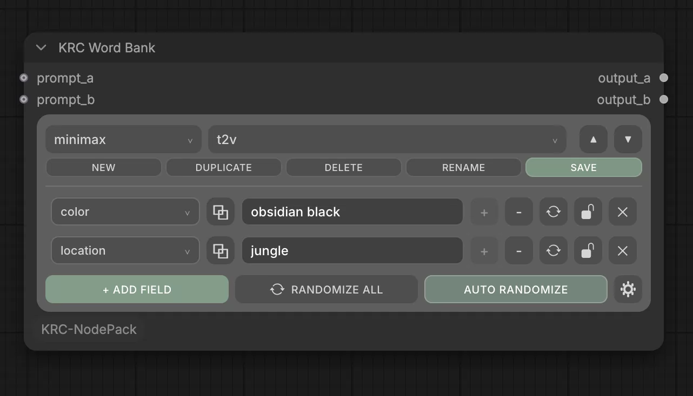

# KRC NodePack

ComfyUI nodes for your LoRAs, models, prompts, media and configs: visual card browsers,
saved presets, and one shared library behind them, the **KRC Portal**.

## KRC Config Switcher

<a href="https://raw.githubusercontent.com/kapakahi/KRC-NodePack/main/docs/images/config_switcher.webp"></a>

Group the settings you tweak most (numbers, dropdowns, seeds, models, prompts, notes) in
one node, save them as named configs, and flip between configs without rewiring. Pair it
with **KRC Config Switcher Link** to send each value where it goes.

## KRC LoRA Loadout

<a href="https://raw.githubusercontent.com/kapakahi/KRC-NodePack/main/docs/images/lora_loadout.webp"></a>

Build two LoRA stacks (A and B) with per-LoRA toggles and strengths, and save them as
presets. **Browse** opens your LoRAs in the Portal; drag a card into a slot. Want the
browser inside the node? Use **KRC LoRA Loadout EX**.

## KRC Prompt Vault

<a href="https://raw.githubusercontent.com/kapakahi/KRC-NodePack/main/docs/images/prompt_vault.webp"></a>

Save, organise and browse your prompts in categories, with thumbnails. Each prompt can
carry a linked LoRA Loadout preset, so picking a prompt switches your LoRAs too. Keep
separate prompt libraries with **profiles**.

## KRC Media Loader and KRC Media Output

<a href="https://raw.githubusercontent.com/kapakahi/KRC-NodePack/main/docs/images/media.webp"></a>

A home for your images and videos, in the Portal's **Media** tab.

- **KRC Media Loader** loads an image or video from a six-slot preset. Upload straight
  into a slot (pick up to six files to fill the next slots too), or drag a card onto one.
- **KRC Media Output** saves your results to Media and shows the last six on the node.
  They also appear in ComfyUI's queue and Assets.

## KRC Word Bank

<a href="https://raw.githubusercontent.com/kapakahi/KRC-NodePack/main/docs/images/word_bank.webp"></a>

Write `<placeholders>` in your text and Word Bank fills each one with a random word from
a matching list. Two outputs, for two independent prompts.

## KRC Model Library

LoRA Loadout's card browser for every other model folder: checkpoints, diffusion models,
VAEs, text encoders, upscalers and more.

## And also

- **KRC LoRA Loadout Loader** applies a LoRA Loadout stack to a `MODEL`.
- **KRC Config Switcher Link** turns Config Switcher's values into separate outputs.

## The KRC Portal

Right-click the canvas and choose **KRC Portal**. Everything is in one window:

- your LoRAs, models, prompts and media, with an Info Panel for each;
- **Fetch** to fill in LoRA and model details from Civitai;
- **Import and Export** to back up or share your libraries;
- **Options**, where every KRC setting lives.

Drag cards from the Portal straight onto nodes.

## Handy things everywhere

- **Cards you can dress up:** favourites, pins, colours, custom badges, and NSFW hiding.
- **Hold to preview:** hold the mouse on a thumbnail for a bigger look.
- **Select several cards** to tag, move or delete them in one go.
- **Eight colour palettes**, for the whole pack or one node at a time.
- **Nothing gets lost:** moved or renamed models are found again automatically, and a
  missing one keeps its name with a **MISSING** badge.
- **Automatic backups** of your libraries, which you can restore from Options.

## KRC NodePack Extras

A companion pack with more nodes built on KRC NodePack:

- **KRC RefMod Loadout:** a stack of MiniMax H3 RefMods, with presets and a token meter.
- **KRC Resizer:** crop, pad and resize with a live preview.
- **KRC Frame Router:** sends a single frame and a clip to different inputs.

Get it at [KRC NodePack Extras](https://github.com/kapakahi/KRC-NodePack-Extras).

## Installation

### ComfyUI Manager

Open **Manager ▸ Custom Nodes Manager**, search for **KRC NodePack**, click **Install**,
and restart ComfyUI.

> **Waiting for Comfy Registry approval:** KRC NodePack can't be installed through Manager
> yet. Until it's approved, use the manual install below.

### Manual install

```
cd ComfyUI/custom_nodes/
git clone https://github.com/kapakahi/KRC-NodePack.git
```

Restart ComfyUI. The nodes are under the **KRC NodePack** category.

Everything works out of the box, video included, with nothing to `pip install` and no
ffmpeg to set up: KRC uses ComfyUI's own video library.

## License

Released under the [GNU General Public License v3.0](LICENSE).
